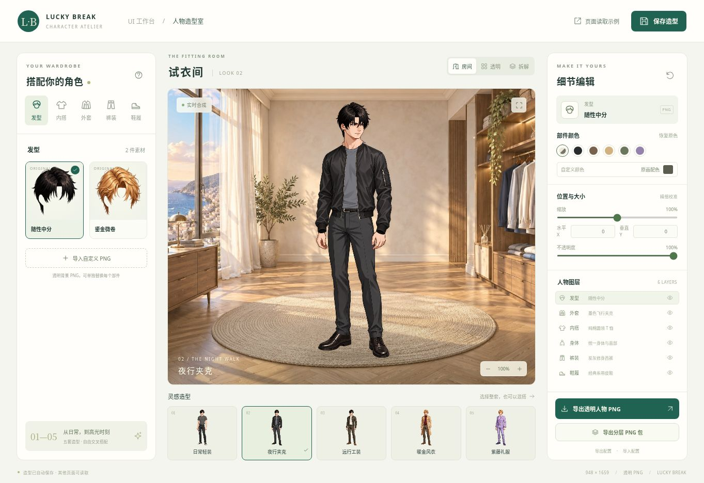

# Run and deploy your AI Studio app

## 人物造型室

在线体验：[人物造型室](https://giogyan90.github.io/UI-tool/wardrobe/index.html) · [其他页面读取示例](https://giogyan90.github.io/UI-tool/wardrobe/reader.html)

新增独立工具页面：[`public/wardrobe/`](public/wardrobe/)，本地启动后打开 `http://localhost:3000/wardrobe/index.html`。包含房间试衣预览、23 张透明 PNG 插画、5 套可混搭造型、10 个编辑图层、完整人物与 12 层 PNG 包导出，以及其他页面读取示例。发型、头部、颈部与后层可精确输入位置和独立宽高，并保存命名预设。随性中分、金色微卷和新增利落背头均拆为前发和后发；风衣的内侧下摆与后背内衬放在腿后，支持跟随前层或独立编辑。头部、发型及颈部连接已统一校准。

接入和素材说明见 [docs/wardrobe.md](public/wardrobe/docs/wardrobe.md)。新页面无需 API Key。main 更新后通过 GitHub Actions 发布到 Pages。

This contains everything you need to run your app locally.

View your app in AI Studio: https://ai.studio/apps/3242cb9e-b2a0-4272-84f0-dcb45316e9b1

## Run Locally

**Prerequisites:**  Node.js

1. Install dependencies:
   `npm install`
2. Set the `GEMINI_API_KEY` in [.env.local](.env.local) to your Gemini API key
3. Run the app:
   `npm run dev`
