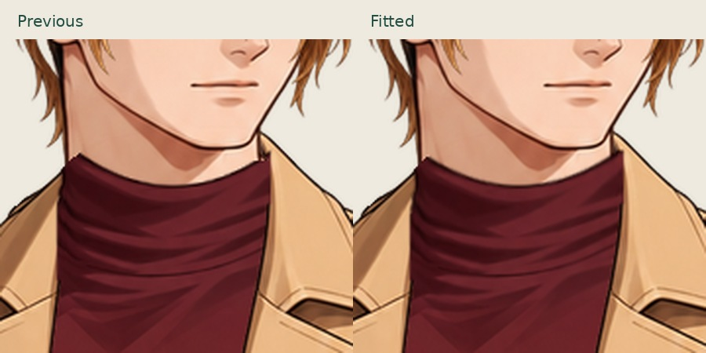

# 颈部贴合与利落背头

2026-11-03。需求：继续修正领子和脖子的错位感；新增背头，两侧和后发剪短。保留上轮的左右对称、只显示正面衣领要求。

## 颈部与领口

高领只替换原图 `[148,0,165,115]` 内的局部补片。对称开口中心由原图 x=227 调为 x=223（人物画布 x=479），半宽由 55 调为 51；两端稍向下收拢，在同一水平高度接近颈侧，中央保持浅 U 形。实际颈部在全局 y=294 的中心为 x=479，避免按整件上衣的中心摆放领口。领口上方是真实透明区域，无后领和深色内腔。

头部原来含有下颌以下约 7 px 的颈部皮肤，会随头部在衣领之后绘制时压住右侧前领。此次按下颌轮廓分离，保留必要的抗锯齿重叠，颈部继续使用同源像素衔接。头部 PNG 保持 160 × 190，包围盒 `[400,103,160,190]` 与存档中的缩放基准不变。

相关文件：`assets/head-base.png`、`assets/top-turtleneck-collar-source.png`、`assets/top-turtleneck-v2.png`、`scripts/build-wardrobe-anatomy.mjs`、`scripts/turtleneck-collar.mjs`。



## 新增发型

使用内置图像生成工具，参考现有无发头部生成背头插画，清掉极低 alpha 的孤立噪点后，裁边、缩放并注册。没有替换人物头脸。

| 文件 / ID | 用途 |
| --- | --- |
| `assets/hair-slickback.png` | 完整已配准制作源，180 × 154 |
| `assets/hair-slickback-front.png` / `hair-slickback` | 利落背头的发际线、向后梳的顶部及短鬓角 |
| `assets/hair-slickback-back.png` / `hair-slickback-back` | 头部与耳朵之后的短后发 |
| `[387,70,180,154]` | 前后两片共用的人物画布坐标 |

后发结束于 y≤224，位于后颈与衣领上方。原黑发与金发继续保留。`register-rear-assets.mjs` 从完整同源 PNG 重建三套前后发；拆片重叠保留源图像素。

## 最终图像生成简报

```text
Use case: compositing. Asset type: isolated hairstyle PNG for a layered Japanese anime character wardrobe. The supplied bald male head is ONLY an anatomical alignment and drawing-style reference. Create ONLY a dark charcoal-black slicked-back men's haircut that fits this exact head in its same three-quarter view facing screen-right. Do not render the head, face, eyes, ears, skin, neck or body: all those regions must be transparent. Hair must be complete as one isolated cutout with a clear empty face/forehead opening. The long upper hair is swept BACK from the forehead in deliberate broad combed strands with modest pompadour volume, clean visible hairline and a fully exposed forehead, no bangs and no loose lock hanging over the face. The two sides and the back/nape are cut SHORT and neat with a close taper above and behind the ears, short sideburns ending near the top of the ears; absolutely no long hair behind the ears or along the neck, no mullet, no ponytail. Preserve the anime cel-shaded ink style of the reference, subtle warm charcoal highlights, defined hair clumps, crisp narrow lines. The silhouette should sit closely over the reference's bald crown and temples, not be an oversized wig. Ear areas remain transparent; it must be possible to overlay this asset on the original unchanged head. Show the entire hairstyle at high resolution, centered, genuine alpha transparency, no checkerboard drawn into pixels, no text, no labels, no background or other objects.
```

## 验收

10 项配置、迁移、保存和 ZIP 单元测试通过；新增背头纳入前后发配对与参数保留检查。素材检查为 23 张透明 PNG、10 个编辑层、5 套预设，约 4.35 MB。

像素验收覆盖五套原造型、背头与五套服装的搭配、20 组内外搭、三套发型及风衣的原图拆片重组、三个十二层 ZIP、头颈锚点、领口中心与对称性、右侧前领不被头部颈部重叠压住、露额、短后颈和所有旧图层功能。补片范围以外的原上衣像素保持不变；领口下方保留原衣服 alpha，单穿时肩侧与胸前不会出现透明接缝。TypeScript 与生产构建通过。

默认运行直接读取 PNG，不需要生成服务；新增发型与旧款使用同一套保存、跟随和导出接口。
