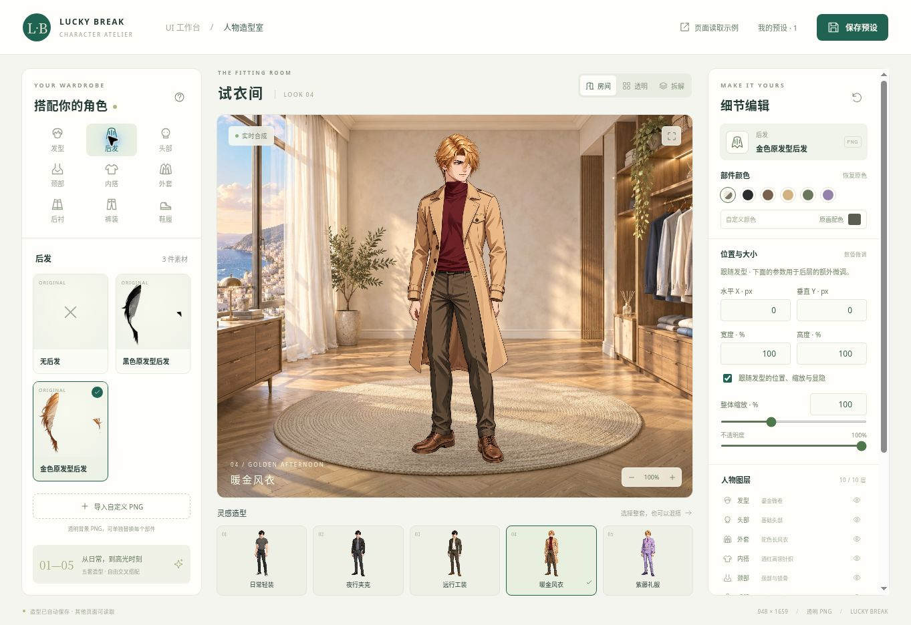
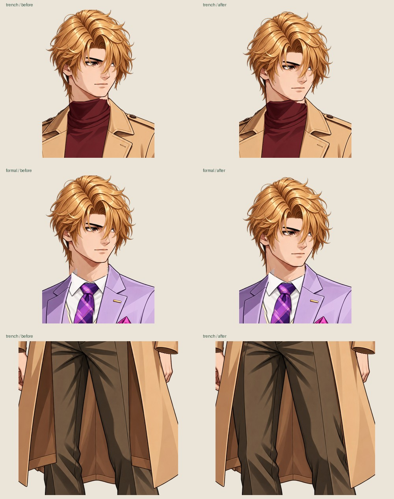
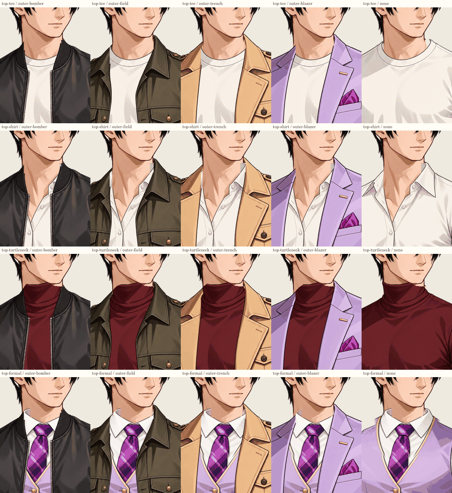

# Lucky Break 人物造型室

独立页面位于 `public/wardrobe/`，由原 UI 工作台顶部入口进入。房间只作为预览背景；人物由真实透明 PNG 合成，可供其他页面和 Three.js 读取。

在线页面：https://giogyan90.github.io/UI-tool/wardrobe/index.html

读取示例：https://giogyan90.github.io/UI-tool/wardrobe/reader.html



## 本地运行与发布

```bash
git clone https://github.com/GioGyan90/UI-tool.git
cd UI-tool
npm ci
npm run dev
# http://localhost:3000/wardrobe/index.html
```

新页面无需 API Key、AI 服务、Node 后端或外部 CDN 即可使用。也可以执行 `npm run dev:wardrobe`，只启动独立静态页面开发服务（默认 localhost:5173）。原 UI 编辑工具的服务端功能仍按原项目运行。`npm run build` 将原工具及 `public/wardrobe/` 一起放进 `dist/`。GitHub Actions 的 `.github/workflows/pages.yml` 在 main 更新后构建并发布整个 dist；Vite 使用相对 base 以支持仓库子路径。

## 已有素材与编辑范围

画布统一为 **948 × 1659**。角色是成年男青年，略朝右侧的四分之三站姿，双手自然垂放，以减少换装时袖长、手掌与裤袋的耦合。参考 T1–T5 重新生成插画，再拆件、裁透明边、校准大小与位置，并非只用五张完整图片切换。

| 类别 | 独立 PNG 素材 |
| --- | --- |
| 头部 | 保留原身份的头脸，与颈部独立 |
| 颈部 | 独立颈部及锁骨补片，填满开领处 |
| 手臂 | 裸露手臂与手掌 |
| 发型前片 | 原黑色随性中分、原金色微卷的脸前与顶部发片 |
| 后发 | 从原黑色、金色短发各自拆出的后脑与后颈发束，可不使用 |
| 内搭 | 短袖 T 恤、白衬衫、酒红高领针织、礼服衬衫与马甲 |
| 外套 | 飞行夹克、工装夹克、长风衣、礼服西装；可不穿外套 |
| 后衬 | 原风衣两片内侧下摆与后背内衬，可不使用 |
| 裤装 | 修身西裤、破洞牛仔裤、休闲裤 |
| 鞋履 | 系带皮鞋、黑白帆布鞋 |

共 **21 张运行时透明 PNG 插画**，约 **4.29 MB**，另有房间 JPG、7 张后领技术遮罩、风衣内侧遮罩，以及保留的原始发型、风衣、skin、礼服和中性颈部制作源。五套预设为日常轻装、夜行夹克、远行工装、暖金风衣、紫藤礼服。十个编辑图层均支持颜色、位置、缩放、不透明度和显隐；发型、后发、内搭、外套、后衬、裤装和鞋履均支持自定义 PNG 导入。两套原短发保留原图笔触与轮廓，不再提供额外生成的长发。此版本马甲和领带属于礼服内搭层。

素材文件在 `public/wardrobe/assets/`，每个 PNG 裁掉无用透明边，位置由 `manifest.json` 中的 `box: [x,y,width,height]` 定义。单个文件不等于完整人物画布，不能忽略 box。白衬衫通过 `mirrorX: true` 统一朝向；礼服 v2 的原图已经朝右，不再镜像。页面预览和导出已烘焙朝向。完整画布的每层 PNG 可从页面导出。

内搭合成时根据外套轮廓裁去超出的肩袖，保留真正透明的前襟开口。长袖服装只保留基础手掌；头脸、颈部不再使用固定高度裁切。实际绘制顺序为后发、外套后衬、鞋、裤、手臂、内搭后领、外套后领、颈部与锁骨、内搭前领与衣身、外套前领与衣身、头部、发型前片。后领在颈后，前领在颈前，开领处由独立锁骨补片填满。后衬会露在风衣内侧与裤腿间，后发束会被头部、肩部与衣身自然遮挡。鞋先画、裤后画，使裤脚盖住鞋口。

旧版六层配置会拆出头部、颈部、手臂，并按原中心继承 skin 的变换；旧版八层配置会补齐后发和后衬，已有手动校准参数保留。当前配置为 `version: 1, rigVersion: 5`，缺少的独立宽高比例默认补为 1。

## 原短发拆分与整体定位（2026-11-03）

头部与发型在原配准基础上一起下移 10 px，颈部的下颌接点同步移动，锁骨与肩线在 y ≥ 350 处保持不动，中间连续压缩过渡。保留 `neck-neutral.png` 作为制作源，避免重复构建累计变形。`rig-registration.mjs` 记录共同锚点。

原黑发与金发分别使用同一组坐标拆成前后片：脸前发丝保留在前层，后脑、耳后和后颈发丝置于头部、颈部与服装之后。不新增长发长度。两个片段重新叠加可复现各自的原始发型，只有被头部和衣领遮挡的后发改变显示关系。

风衣沿原两条内侧接缝拆分，米色外侧前摆继续留在前层，两片深棕内摆移入后衬，裤腿盖在它们前面。原 `outer-trench.png` 保留，运行时前后片分别为 `outer-trench-front.png`、`outer-trench-back.png`。

旧预设中的额外长发自动迁移为原金色短发，移除旧长后束的位置和比例；原头部、颈部、前发的手动参数保留。旧版短发的空后发自动补上对应原后发，新版本明确选择「无后发」则保持该选择。

## 前后分层与跟随

黑色随性中分自动配上 `hair-black-back`，金色微卷自动配上 `hair-blonde-back`；两套后发均来自对应的原短发 PNG。风衣自动配上 `outer-trench-lining`，包含后背与从原前片剥离的两处内侧下摆。其他外套使用空后衬，也可在「后发」「后衬」分类单独选择、隐藏、换色或导入 PNG。

后层默认勾选「跟随前层」：后发跟随发型，后衬跟随外套的位置、缩放、显隐和不透明度，未单独染色时沿用前层的自定义颜色。后层的 X/Y 与缩放是叠加在跟随关系上的额外调整。取消勾选后可完全独立摆放；还原后层会恢复跟随。内衬跟随时还会限制在外套轮廓之内，避免越过肩线和衣摆。跟随开关与后层参数都保存到命名预设和配置 JSON。

| 编辑图层 | 配置 kind | 位置 |
| --- | --- | --- |
| 原短发的后脑与后颈发束 | `hair-back` | 身体、头部、衣服之后 |
| 外套内侧下摆与后背内衬 | `outer-back` | 身体、裤装与外套前片之后 |
| 内搭后领 / 外套后领 | `top-collar-back` / `outer-collar-back` | 技术导出层，位于颈部之后 |

`manifest.assets[].backAsset` 指定前片自动配对的后片；`clipToParent: true` 可使跟随的后片限制在前片轮廓内部。左右鞋、完整人物和其他页面读取使用同一套十二层绘制顺序。

## 发型、头部与颈部数值校准

左侧直接选择「发型」「头部」「颈部」，在右侧「位置与大小」输入参数。三个部件独立调整；调整头部不会连带移动发型。

| 字段 | 范围及含义 |
| --- | --- |
| 水平 X / 垂直 Y | -400～400 原画像素；正值向右 / 向下，支持 0.1 px |
| 宽度 / 高度 | 50～200%，分别控制横向和纵向比例，支持 0.1% |
| 整体缩放 | 25～250%，同时放大或缩小两个方向，支持 0.1% |

位置与缩放以各部件原画包围盒中心为基准。配置中 `scale` 是整体缩放，`scaleX` / `scaleY` 是独立宽高倍率；最终宽度为原宽 × `scale` × `scaleX`，高度同理。还原当前图层会将位移归零、三种比例归一。

顶部「保存预设」打开命名预设窗口：输入名称后保存新预设；「我的预设」可以选择并应用已有预设，也可以用当前画面更新所选预设。每份预设是整套造型的独立快照，包含三组校准参数、服装、颜色和自定义素材引用。修改当前造型不会自动覆盖已有命名预设。

命名预设保存在当前浏览器的 IndexedDB 中，每份使用独立记录，不改动原五套概念预设。跨设备备份时先应用某个预设，再导出配置 JSON；在另一浏览器导入后可重新命名保存。配置 JSON 只包含当前这一份造型，不包含整个预设列表。

## 读取完整人物

打开 `wardrobe/reader.html` 可实际验证不同页面同步。编辑状态在当前浏览器自动保存，IndexedDB 存自定义 PNG 与状态，localStorage 保存轻量配置备份，BroadcastChannel / storage 事件通知其他页面。浏览器保存不等于跨设备云存档；换设备请导入带素材的配置 JSON。

在**同源**任意页面中使用：

```html
<canvas id="character"></canvas>
<script type="module">
  import { loadState, renderAvatar, subscribeAvatar, getAvatarBlob }
    from './wardrobe/avatar-sdk.js';

  const canvas = document.querySelector('#character');
  await renderAvatar(canvas, await loadState());
  const unsubscribe = subscribeAvatar(state => renderAvatar(canvas, state));
  // 页面/组件卸载时调用 unsubscribe()。
  // const transparentPNG = await getAvatarBlob(); // Blob, image/png
</script>
```

在工具页面本身也可以通过 `window.LuckyBreakAvatar.getCurrentState()` 取得当前配置，通过 `getCurrentPNG()` 取得当前完整人物 PNG Blob。SDK 的通用方法包括 `getManifest()`、`createState(manifest, presetId)`、`loadState()`、`saveState(state)`、`listSavedPresets()`、`savePreset(state,name,{id,manifest})`、`renderAvatar(canvas, state)`、`renderLayer(kind,state)`、`renderCompositeLayers(state)`、`getAvatarBlob(state)`、`subscribeAvatar(callback)`、`exportConfig(state)` 与 `importConfig(config)`。不传 `id` 时 `savePreset` 新建快照，传入已有 `id` 时更新该预设；它不会同时覆盖当前造型，需要时另调用 `saveState(record.state)`。

`renderLayer()` 返回十个编辑部件中的单件，衣领仍完整；需要复现人物遮挡或自行打包时使用 `renderCompositeLayers()`，它按 `COMPOSITE_ORDER` 返回十二张 `{ kind, canvas }`，包含两个真实后片并拆开前后领。按返回顺序在同尺寸透明画布上叠加即可得到完整人物。

仅嵌入透明人物，不显示示例说明：

```html
<iframe src="./wardrobe/reader.html?embed=1"
  title="当前人物" style="width:380px;height:665px;border:0"></iframe>
```

Three.js 示例（沿用游戏已有的 three 依赖）：

```js
import * as THREE from 'three';
import { loadState, renderAvatar, subscribeAvatar } from './wardrobe/avatar-sdk.js';

const canvas = document.createElement('canvas');
await renderAvatar(canvas, await loadState());
const texture = new THREE.CanvasTexture(canvas);
texture.colorSpace = THREE.SRGBColorSpace;
const material = new THREE.SpriteMaterial({ map: texture, transparent: true });
const sprite = new THREE.Sprite(material);
sprite.scale.set(948 / 1659 * 2, 2, 1);
scene.add(sprite);
const stop = subscribeAvatar(async state => {
  await renderAvatar(canvas, state);
  texture.needsUpdate = true;
});
// 卸载：stop(); material.dispose(); texture.dispose();
```

跨域、跨设备或本地游戏使用时，将 `public/wardrobe/` 一并复制进游戏资源目录，导入配置与自定义素材再合成，或直接使用导出的完整 PNG。浏览器本地存储不会自动跨域共享。自定义素材只接受真实 PNG，单件最大 10 MB，宽高最大 4096；导入定位可选择部件适配或完整画布对齐。

## 导出

- **透明人物 PNG**：只导出人物，无房间、地毯或 UI，原始画布尺寸。
- **分层 PNG ZIP**：`character.png`、12 个统一尺寸的实际合成图层 PNG、含自定义素材的 `look.json` 与说明。内搭与外套各拆为后领及前领/衣身两张，因此比十个编辑部件多两层。图层文件已烘焙颜色、朝向、变换、跟随、透明度、显隐和遮挡裁剪。按 `00-hair-back.png` 至 `11-hair.png` 的文件名顺序从下往上以 `(0,0)` 叠加可复现完整人物。
- **配置 JSON**：可回到造型室继续编辑，包含自定义 PNG 数据。

原始完整部件 PNG 保留在 assets，导出的当前外观图层可能因外套遮挡而被裁剪。房间、透明底、拆解模式和预览缩放不影响最终导出构图。

## 继续增加素材

1. 以相同人物姿势、面部角度、肢体位置生成真正透明背景的单件插画；不能让衣服生成时带上头脸、皮肤、其他衣物或鞋。
2. 保持领口、肩、腰、腕、脚踝基准，生成后按 `manifest.json` 校准。长外套必须具有真实的前襟透明开口。
3. 将新文件加入 assets，再加入 manifest 同类别的素材项。需要时设置 `sleeve: "long"`、`mirrorX: true`；存在后领时配置同尺寸 `rearCollar.file` alpha 遮罩。新自定义 PNG 默认整体置于颈部前方，有后领时需在清单中提供遮罩。检查无外套、短夹克、风衣等交叉组合。
4. 一般不需要重新生成身体。改变姿势则需重建整个套件，不能把不同站姿的服装直接混用。

`public/wardrobe/scripts/prepare-wardrobe-assets.mjs` 是机械素材整理脚本：输入本地生成 PNG 路径映射（键为素材 ID，房间键为 room，新颈部源图键为 neck），使用 sharp 裁透明边、拆分左右鞋及身体、校准坐标、导出 manifest。末尾调用 `build-wardrobe-anatomy.mjs`，拆出原头脸和手臂、注册并收紧颈部轮廓、生成后领遮罩。也可单独运行 `node public/wardrobe/scripts/build-wardrobe-anatomy.mjs [颈部源图.png]`；无参数时从保留的 `neck-neutral.png` 重新注册颈部，重复执行不会累计压缩。原 `assets/skin.png` 是拆分源，运行时身体项已指向 `skin-arms.png`。只在重新整理源插画时运行；日常构建无需 sharp，也不会调用图像服务。

`register-rear-assets.mjs [礼服生成源图] [风衣后衬源图]` 整理后层素材。礼服仅替换领口局部，其他部分继续使用原校准图。每次执行均从完整黑发、金发原图拆出前后发，从原风衣分离两片内侧下摆，并与保留的后背源图合成运行时后衬；不再接受新长发素材。`build-wardrobe-anatomy.mjs` 会识别这些素材并保留后层配置，再按新的领口 alpha 生成遮罩。高领遮罩沿原前缘墨线绘制，避免扩张遮罩抹掉布料上沿。

## 检查

```bash
node public/wardrobe/scripts/check-wardrobe.mjs
node --test public/wardrobe/tests/wardrobe.test.mjs
npx tsc --noEmit
npm run build
```

可选像素验收（本机另需 `@napi-rs/canvas` 和 `sharp`，无需加入生产依赖）：

```bash
npm install --no-save --package-lock=false @napi-rs/canvas sharp
node public/wardrobe/scripts/verify-wardrobe-render.mjs /tmp/wardrobe-render-qa
```

该脚本导出五套人物、十二层 ZIP、含原短发后片及腿后内衬的风衣 ZIP 与 20 组领口接触图，并检查原发型/风衣前后片重组保留原像素、两侧内摆位于裤腿之后、头颈锚点、前后领 alpha、导出重组、后层遮挡和跟随、独立校准、开领肤色及肩线朝向。

还需在浏览器目测五套完整人物、至少一组交叉混搭、透明底、拆解模式、PNG/ZIP 导出、上传与配置恢复，以及 reader 页跨标签同步。发布后的页面也应实际打开，确认资源在 GitHub 仓库路径下可加载。

2026-11-02 初版验收：TypeScript 检查通过；桌面与 390px 预览目测完成，浏览器自定义 PNG 导入、含自定义 PNG/颜色/位置的 JSON 恢复、跨标签人物同步通过。

2026-11-02 头颈修正版验收：素材检查、5 项配置/迁移/ZIP 测试及 Vite 构建通过。底层渲染器导出五套透明 PNG、20 组内搭/外套领口接触图和礼服十层 ZIP；ZIP CRC 正确，十层重合成与完整人物逐像素一致，前后领合并 alpha 误差不超过 1/255、预乘 RGB 误差不超过 2/255（透明边缘舍入）。颈部移动不影响头部，开领处检测到 3920 个连续肤色像素；白衬衫及礼服肩线朝向通过检查。浏览器已验证八层拆解及颈部独立移动/还原。云浏览器未能捕获 Blob 下载事件；导出内容已在渲染器和 ZIP 层验证。

2026-11-02 数值校准与预设验收：7 项测试通过，包含小数位置及独立宽高的配置恢复、命名快照隔离与更新。像素检查验证发型、头部、颈部横向调整不改变高度，校准后配置恢复及十层合成像素一致。浏览器实际保存三组不同参数，切换概念造型后重新应用，三组字段值全部恢复；另存第二份预设、更新第一份、刷新后应用第二份，第二份仍保留独立参数。

2026-11-02 后层扩展验收：8 项测试通过，包含旧配置自动配对后层且保留手动颈部参数。像素验收覆盖 5 套预设、20 组内外搭、12 层导出、后层遮挡、跟随与解除跟随。该轮额外生成的长发已在下一版移除。

2026-11-03 原短发拆分与对齐验收：10 项配置、迁移、颈部锚点与 ZIP 测试通过；素材检查与 Vite 构建通过。像素检查覆盖五套预设、20 组混搭、原短发和风衣拆片重组、12,235 个裤腿盖住两侧内摆的像素、头颈锚点与后层跟随。两个十二层 ZIP 独立解码、CRC 和 alpha/RGB 重组检查通过。重复整理素材的文件哈希完全一致。浏览器验证了两种前发、三种后发选择、十层拆解、命名预设的位置/独立高度恢复，以及读取页跨标签同步。




